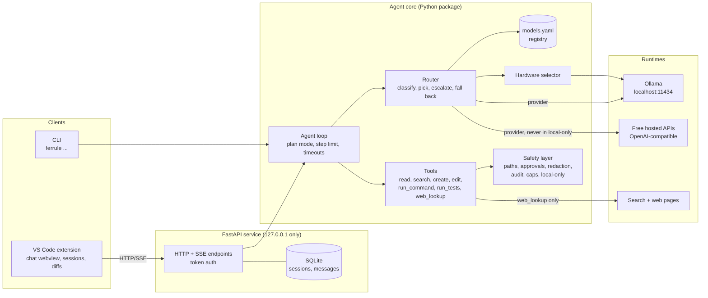

# 02 — Architecture

This is the design for Ferrule, based on [01-requirements.md](01-requirements.md). Requirement IDs (F1…, N1…) are written in brackets. No code exists yet.

## 1. Components



The CLI calls the core directly, in the same process. The extension only talks to the service. Both use the same `Agent` class, the same events and the same safety layer, so the CLI and the HTTP API behave the same way. That is the Phase 7 gate.

## 2. Key decisions

### D1. Language for the agent core
| Option | For | Against |
|---|---|---|
| **Python** | psutil, FastAPI, Pydantic and pytest are already the planned tools; good Ollama support; fast to write and test | Two languages in the repo, since the extension must be TypeScript |
| TypeScript (Node) | One language for core and extension | Hardware detection is weaker; the PDF's stack and eval tooling are Python; the extension would have to share a process model with the core |

**Choice: Python 3.12+.** The dev machine has 3.14. If any dependency has no 3.14 wheel, use a 3.12 virtual environment.

### D2. How to talk to models
| Option | For | Against |
|---|---|---|
| Ollama native `/api/chat` and a separate OpenAI client for hosted | Native API exposes everything Ollama can do | Two chat code paths to write and test |
| **One OpenAI-compatible chat client (httpx), plus a small Ollama admin client** | Ollama serves `/v1/chat/completions`, so local and hosted share one chat path (F16 fallback becomes "same client, different base URL"); a new hosted tier only needs config | The model list, pull and loaded-model info still need the native API (`/api/tags`, `/api/pull`, `/api/ps`) |
| LiteLLM or another SDK wrapper | Many providers out of the box | Large dependency; hides the HTTP errors (429, timeouts) the router must see; harder to explain in an interview |

**Choice: one `OpenAICompatProvider` built on `httpx.AsyncClient`, plus `OllamaAdmin` for list, pull and ps.** Tests use `httpx.MockTransport`, so no extra mocking library is needed.

### D3. Tool-call format
| Option | For | Against |
|---|---|---|
| Native function calling (`tools` parameter) only | Structured; works well on models trained for it (e.g. qwen2.5-coder) | Some local models, such as deepseek-coder:6.7b, don't support it |
| Prompted JSON only (the model writes a fenced JSON block) | Works with any model | Less reliable on models that do support native calls |
| **Both, chosen per model by the registry flag `supports_tools`** | Uses native calls where they exist and still supports the rest | Two parsers. Both produce the same `ToolCall`, which goes through one Pydantic validation step (F5). |

### D4. Sync or async core
| Option | For | Against |
|---|---|---|
| Sync loop in a worker thread | Simpler code | Cancellation and waiting for approval across threads is awkward; SSE needs bridging |
| **async loop** | FastAPI SSE, cancellation (`task.cancel()`) and waiting for approval (`asyncio.Future`) are built in | The CLI must call `asyncio.run`. Tests use the anyio pytest plugin, which already comes with httpx. |

**Choice: async.**

### D5. Session storage
| Option | For | Against |
|---|---|---|
| JSON file per session | Easy to inspect | Partial writes can corrupt files; listing and searching means reading every file |
| **SQLite (stdlib `sqlite3`)** | Atomic writes; listing and search are cheap queries; no extra dependency | Needs a tiny schema |

**Choice: SQLite**, at `$FERRULE_HOME/sessions.db` (default `~/.ferrule/`).

### D6. Streaming
| Option | For | Against |
|---|---|---|
| **SSE for the stream, plain POST for approve, reject and cancel** | One-way stream matches the job; easy to watch with `curl -N`; simple to parse in the extension | No messages from client to server on the same connection (not needed) |
| WebSocket | Two-way | More state to manage (reconnects, ping); harder to test with curl |

**Choice: SSE.**

### D7. CLI framework
argparse (stdlib) versus Typer or Click. **argparse.** There are only a few subcommands (`run`, `plan`, `doctor`, `undo`, `serve`), so a dependency isn't worth it.

### D8. Registry format
YAML versus TOML versus JSON. **YAML (PyYAML).** People edit it, it allows comments, and the eval configs are YAML anyway. The stdlib's `tomllib` can't write files, and the eval harness writes scores back into the registry.

## 3. The agent loop

```
run(task, mode):
  model = router.pick(classify(task))            # emits a routing event (F14, F17)
  if mode == plan:
      plan = model.chat(PLAN_PROMPT + task)       # no tools offered
      emit plan; if not approver.approve(plan): stop (F11)
  messages = [system(tools), user(task)]
  for step in 1..max_steps:                       # F10
      reply = await with_timeout(model.chat(messages, tools))
      if reply is final answer: emit done; return
      call = parse_and_validate(reply)            # Pydantic (F5)
      if invalid: messages += error; invalid_count++
                  if invalid_count > max_retries: model = router.escalate(...) or fail (F15)
                  continue
      result = await tools.run(call)              # safety and approvals inside
      messages += result (redacted, truncated)
      if result is a test failure seen twice: router.escalate / suggest web_lookup (F15, F24)
  emit stopped(reason="max_steps")
```

Everything the loop does is sent as a typed **event**: `token`, `routing`, `tool_call`, `tool_result`, `approval_request`, `notice`, `error`, `done`. The CLI prints them and the service forwards them as SSE. That's the only integration point.

**Approvals** go through an `Approver` protocol, `async approve(request) -> bool`.
- `CliApprover` asks on stdin.
- `ApiApprover` sends `approval_request` and waits on a Future that the approve or reject endpoint resolves.
- Tests use `ScriptedApprover`.
- Approval levels: `ask` (every change asks) and `auto_safe` (`run_tests` and `git status|diff|log|show` are auto-approved; edits, file creation and other commands still ask). Read-only tools never ask.

**Undo (F12):** *(changed in Phase 3; the earlier design used `git stash create`)*. Before a tool first changes a file, it saves that file's original content, or "created" for a new file, to `$FERRULE_HOME/checkpoints/<workspace-hash>.json`. `ferrule undo` writes the originals back and deletes created files. This also covers untracked files and folders that aren't git repositories, which `git stash create` can't restore. The user's own git history is never touched.

## 4. Tool interface

```python
class Tool(Protocol):
    name: str
    description: str
    Args: type[BaseModel]          # Pydantic model; its JSON schema goes to the model
    read_only: bool                # read-only tools skip approval
    async def run(self, args: BaseModel, ctx: ToolContext) -> ToolResult: ...

class ToolResult(BaseModel):
    ok: bool
    output: str                    # truncated to ctx.max_output_chars, redacted
    error: str | None = None
```

`ToolContext` holds the workspace root, approver, audit log, settings and a list of changed files. Tools never use paths without going through `ctx.resolve(path)`.

| Tool | Args | Read-only | Notes |
|---|---|---|---|
| `read_file` | `path`, `start_line?`, `end_line?` | yes | Refuses secret files (N2) |
| `search_repo` | `pattern`, `glob?`, `regex: bool` | yes | Pure Python walk; skips `.git`, `node_modules`, binary files; result count capped |
| `create_file` | `path`, `content` | no | Fails if the file exists; asks for approval |
| `edit_file` | `path`, `old`, `new` | no | Replace an exact text match; `old` must match once. The diff comes from `difflib.unified_diff` and is shown in the approval request. |
| `run_command` | `argv: list[str]` | no | Program must be on the allowlist; `shell=False`; timeout |
| `run_tests` | none (uses the configured command) | no* | *Approved once per session, since the command is fixed by config |
| `web_lookup` | `query` | yes | See §8 |

`edit_file` uses an exact text match rather than a model-written diff. Small models write broken unified diffs much more often than they get an exact string wrong, and an exact-match failure gives a clear error to send back.

## 5. Providers and registry

```python
class Provider(Protocol):
    name: str
    is_local: bool
    async def chat(self, model, messages, tools=None, stream=True) -> AsyncIterator[Chunk]: ...
```

Errors are split into types: `RateLimited` (429), `Unavailable` (connection refused, timeout, 5xx), `BadResponse`. The router treats the first two as "fall back" and the last as "retry, then escalate".

`models.yaml`:
```yaml
providers:
  ollama:
    base_url: http://127.0.0.1:11434/v1
    local: true
  groq:                                   # example hosted tier; disabled until a key is set
    base_url: https://api.groq.com/openai/v1
    api_key_env: GROQ_API_KEY             # name of the env var, never the key itself
    local: false
    caps: {requests_per_minute: 30, requests_per_day: 1000}   # check the provider's current limits

models:
  - name: qwen2.5-coder:7b
    provider: ollama
    params_b: 7.6
    quant: q4
    context: 32768
    supports_tools: true
    scores: {}                            # filled ONLY by the eval harness: {class: success_rate}
```

Hosted rate limits in the example are placeholders that must be checked against each provider's current terms (see the PDF §5).

## 6. Router

1. **Classify (F13).** Simple rules in order:
   - estimated prompt tokens > 50% of the default model's context → `long_context`
   - several paths mentioned or words like "rename across" / "refactor" → `multi_file_refactor`
   - traceback or "error" / "fails" / "bug" → `debug`
   - "test" → `tests`
   - "explain" / "what does" → `explain`
   - "add route/model/Dockerfile/CI" → `boilerplate`
   - anything else → `small_edit`

   The rules are a table in code, and the tests use the same table.
2. **Candidates.** Registry models where all of these hold:
   - the provider is up and not cooling down
   - it's local, or local-only mode is off (N5)
   - it's under its caps (F18, N7)
   - its context fits the task
   - if it's local, the hardware selector says it fits
3. **Rank.** Sort by `scores[class]`. Models with no score are ranked after scored ones, by `params_b`, largest first. Scores stay empty until Phase 10, so before that the router simply prefers larger models that fit.
4. **Escalate (F15).** After repeated invalid output or failing tests, move to the next candidate up the list. Each task can escalate at most a set number of times.
5. **Fall back (F16).** On `RateLimited` or `Unavailable`, the provider cools down for a set time and the router tries the next candidate.
6. **Notice (N6).** Before the first call to a non-local provider in a session, send a `notice` event naming the provider.
7. **Log (F17).** Every decision is recorded: `{class, candidates, chosen, reason}`, sent as a `routing` event and written to the audit log.

## 7. Hardware selector

- **Detect (F19):**
  - RAM total and free, CPU core count, free disk: psutil
  - GPU name, total and free VRAM: `nvidia-smi --query-gpu=name,memory.total,memory.free --format=csv,noheader,nounits` if it exists; otherwise no GPU is reported
- **Estimate (F20), labelled as an estimate:** `mem_gb ≈ params_b × 0.6 + context_overhead_gb`. The overhead is a set amount per 4k tokens of context. The numbers live in config with a comment, and the PDF's 0.6 GB per billion parameters at 4-bit is the starting value.
- **Budget:** `0.7 × (free RAM + free VRAM)`. Ollama splits model layers between GPU and CPU, so both count. Models that fit only partly in VRAM run slower, and the speed test catches that.
- **Choose:** the largest installed or registered local model under the budget. If it isn't installed, ask before pulling it through `/api/pull` (F22).
- **Verify (F21):** send a short fixed prompt and compute tokens per second from Ollama's `eval_count / eval_duration`. If it's below `min_tokens_per_sec` (config; the default is a starting guess to replace after Phase 5) or the model fails to load, step down to the next smaller model.
- **Override and explain (F23):** `FERRULE_LOCAL_MODEL` or `--model` wins. `ferrule doctor` prints the detected numbers, each model's estimate, the budget, and why each model was chosen or skipped.

On the dev machine (GTX 1650, 4 GB; 24 GB RAM) the 7B models are expected to run partly on the CPU. This is unmeasured; Phase 5 records the real speed.

## 8. Web lookup tool

The pipeline:
1. **Sanitize (F24).** Strip Windows and Unix paths, the current username, anything the redactor finds (keys, tokens, emails), and quoted code longer than a few lines. Keep the exception type and message.
2. **Preview (F27).** If enabled, show the sanitized query for approval.
3. **Search.** The search backend is chosen in config:
   - `github_issues`: the free GitHub search API; works without a key at a low rate limit
   - `docs_site`: a site-limited search through a set list of docs domains
   - `search_api`: any key-based API the user configures
4. **Fetch.** The top k results, with httpx, a timeout and a byte limit, checked against the domain allowlist and blocklist (F27).
5. **Clean.** A stdlib `html.parser` subclass drops `script`, `style`, `nav`, `header`, `footer` and `aside`, keeps text and `<pre>`/`<code>`. A heavier extractor can be added only if the eval shows this one isn't good enough.
6. **Summarize.** The currently routed model summarizes the cleaned text into a short answer under the token limit, with source URLs (F25). The page text is placed inside clear "untrusted content" markers, and the system prompt says it is data only (F26). Commands it suggests still go through `run_command` approval no matter what.
7. **Cache.** Results are stored on disk, keyed by the hash of the sanitized query. There is a cap on searches per task.
8. **Local-only mode.** The tool is removed from the tool list and returns `disabled` if called (F28).

## 9. Safety layer

| Concern | Mechanism |
|---|---|
| Workspace-only (N1) | `resolve(p) = os.path.realpath(root / p)`. Reject unless `Path(resolved).is_relative_to(realpath(root))`. Resolving the real path first catches `../`, absolute paths, symlinks and Windows junctions. Path comparison ignores case on Windows. For new files, the parent directory is the one resolved. |
| Secret files (N2) | Deny-list of patterns: `.env*` except `.env.example`, `*.pem`, `*.key`, `id_rsa*`, `id_ed25519*`, `.git/config`, `*credentials*`. Configurable. |
| Commands (F6) | `argv` list only, `shell=False`. `argv[0]` must be on the allowlist (default: `python`, `pytest`, `ruff`, `git` limited to `status|diff|log|show`, `npm` limited to `test|run`). Arguments containing shell syntax like `&&`, `;`, `|` or backticks are refused, as extra protection. |
| Redaction (N3) | Regexes for common key formats (`sk-…`, `ghp_…`, `AKIA…`, `xox…-`, JWTs, `-----BEGIN … KEY-----`), plus the exact values of any env var whose name contains KEY, TOKEN or SECRET. Applied to logs, audit lines, prompts sent to hosted providers, and search queries. |
| Audit (N4) | One JSON line per tool call, approval, routing decision and hosted call, written to `$FERRULE_HOME/audit.log` and redacted before writing. |
| Caps (N7, F18) | Request counters per provider and per session, kept in memory and in the session row. |
| Local-only (N5) | A single setting. When on, the router drops non-local candidates and web_lookup is unregistered. Tests check that a mocked hosted provider gets zero calls. |

## 10. FastAPI service

The service binds to `127.0.0.1` only, which is set in code and can't be configured (F29). Every request needs `Authorization: Bearer <token>` (F30). The token is created with `secrets.token_urlsafe(32)` on first start and saved to `$FERRULE_HOME/token`, readable only by the user. Comparison uses `secrets.compare_digest`.

| Method | Path | Purpose |
|---|---|---|
| GET | `/health` | Liveness check plus Ollama reachability |
| POST | `/sessions` | Create a session `{workspace, mode}` |
| GET | `/sessions?q=` | List and search sessions |
| GET | `/sessions/{id}` | History |
| DELETE | `/sessions/{id}` | Delete a session |
| POST | `/sessions/{id}/messages` | Send a message. The response is an **SSE stream** of the events in §3. |
| POST | `/sessions/{id}/approvals/{approval_id}` | `{approve: bool}` |
| POST | `/sessions/{id}/cancel` | Cancel the running loop |
| GET / PATCH | `/settings` | mode, approval level, model profile, local-only, caps |
| GET | `/models` | Registry, installed models, hardware choice |

OpenAPI docs come from FastAPI at `/docs`, and those also require the token.

SQLite tables: `sessions(id, workspace, created_at, title, settings_json)` and `messages(id, session_id, seq, role, kind, payload_json, created_at)`.

## 11. VS Code extension

```
extension/
  package.json          # contributes: views (chat webview, sessions tree), commands, settings
  src/extension.ts      # activate(): register views and commands
  src/client.ts         # fetch + SSE parser; token from settings or $FERRULE_HOME/token
  src/messages.ts       # pure functions: event -> UI state  (unit-tested)
  src/chatView.ts       # WebviewViewProvider
  src/sessionsView.ts   # TreeDataProvider with search, refresh, delete
  src/diff.ts           # TextDocumentContentProvider for proposed content + vscode.diff
  media/chat.js, chat.css, icon.svg
```

- **One writer.** When an `edit_file` approval request arrives, the extension opens `vscode.diff(current file, ferrule-proposed:/path)`. Accept or reject sends a POST to the approvals endpoint, and the backend makes the file change. The extension never writes files itself, so the CLI and the extension follow the same safety path.
- **Webview security.** A strict CSP: `default-src 'none'`, scripts only from the extension with a nonce, no remote scripts (Phase 9).
- **Context.** The active file path and selection are attached to each message as context.
- **Service not running.** The extension shows a "Start service" action that runs `ferrule serve`, and retries when the service restarts.

## 12. Folder structure

```
ferrule/
  __main__.py            # python -m ferrule
  cli.py                 # argparse: run, plan, doctor, undo, serve
  config.py              # settings from env + defaults (pydantic)
  events.py              # event types
  agent.py               # loop, plan mode, Approver protocol
  providers.py           # Provider protocol, OpenAICompatProvider, OllamaAdmin, error types
  tools/
    __init__.py          # registry + ToolContext
    files.py             # read_file, search_repo, create_file, edit_file
    commands.py          # run_command, run_tests
    web.py               # web_lookup (Phase 6)
  safety.py              # paths, secret files, allowlist, redaction, audit, caps
  router.py              # classify, rank, escalate, fall back (Phase 5)
  hardware.py            # detect, estimate, select, speed test (Phase 5)
  api.py                 # FastAPI app (Phase 7)
  store.py               # SQLite sessions (Phase 7)
models.yaml
eval/                    # Phase 4
extension/               # Phase 8
tests/
  conftest.py            # MockProvider, ScriptedApprover, tmp workspace fixtures
  test_*.py ; web_lookup/ ; api/ ; security/
pyproject.toml           # deps: httpx, pydantic, pyyaml, psutil, fastapi, uvicorn; dev: pytest, ruff
.env.example
```

The package is kept flat on purpose. A module gets split into a subpackage only when it grows past about 400 lines.
